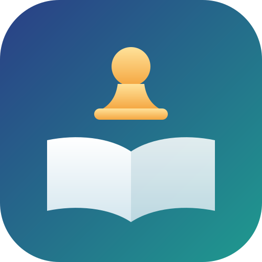
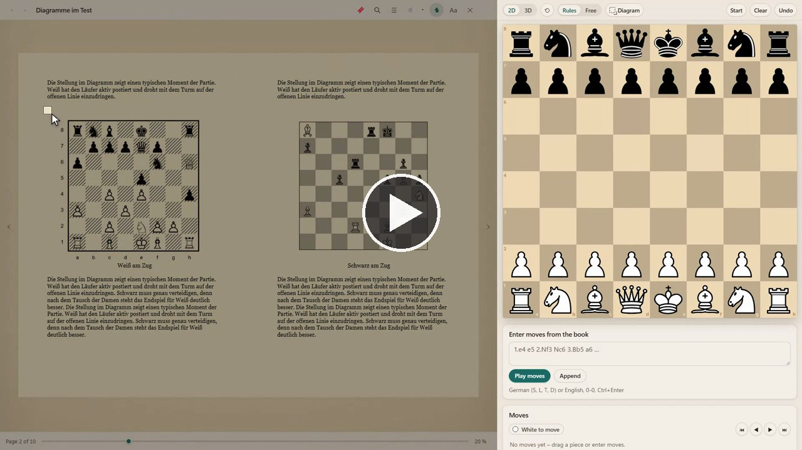

<p align="center"></p>

# Chess Reader

*English: [README.md](README.md)*

<p align="center"><a href="https://github.com/regard2462/Chess-Reader/releases/download/v0.1.0/chess-reader-demo.mp4"></a><br><a href="https://github.com/regard2462/Chess-Reader/releases/download/v0.1.0/chess-reader-demo.mp4">Demovideo ansehen (1 Minute, ohne Ton)</a></p>

Chess Reader ist ein E-Reader für die Bücher auf deinem eigenen Rechner. Du wählst einen Ordner, die Bücher erscheinen als
Liste von Covern, und jedes Buch öffnet sich in einem Vollbild-Leser mit Seitenwechsel, Lesezeichen, Notizen, Inhaltsverzeichnis
und einer Suche im Buch. In Schachbüchern setzt ein Rahmen um ein Diagramm dessen Stellung auf ein Schachbrett neben der Seite.

Der Leser ist der von Cozy Shelves, der begehbaren 3D-Bücherei, als eigenes Programm: derselbe Leser und dieselbe
Diagrammerkennung, ohne die 3D-Welt. Am Leser selbst wurde dafür nichts geändert.

Chess Reader läuft unter Windows, Linux, macOS und Android, siehe [Systeme](#systeme). Die Oberfläche gibt es auf Deutsch und Englisch. Die Bücher bleiben, wo sie
sind, das Programm liest sie nur. Lesezeichen, Notizen und Leseposition merkt sich das Programm.

## Funktionen

**Bücher**
- EPUB, PDF, MOBI, AZW3, FB2, CBZ, TXT, MD und HTML.
- Eine Liste von Covern mit Suchfeld und den Sortierungen „Zuletzt gelesen“, Titel und Autor. Die Cover stammen aus den Büchern
  selbst, ein Buch ohne Cover bekommt eine Titelkarte.
- Unter jedem begonnenen Buch steht ein Fortschrittsbalken. Die Leseposition wird gemerkt.

**Der Leser**
- Seitenwechsel mit den Pfeiltasten, der Maus oder den Seitenrändern, auf Wunsch animiert. Eine Seite, zwei Seiten oder Scrollen.
- Das Darstellungsmenü (`S`): Seitenfarbe (Weiß, Papier, Sepia, Nacht), Schrift (EB Garamond, Literata, Source Serif, Palatino,
  Atkinson Hyperlegible, Segoe UI), Schriftgröße, Seitenbreite, Zeilenabstand, Blocksatz und Silbentrennung.
- Lesezeichen (`B`), Notizen zu markiertem Text, Inhaltsverzeichnis und eine Suche im Buch (`T`).
- Ein PDF lässt sich als Seiten oder als fließender Text in deiner Schrift und Spaltenbreite zeigen (`X`).

**Schachbücher**
- `C` setzt ein Schachbrett neben die Seite, `D` startet das Diagramm-Lasso. Ziehe einen Rahmen um ein Diagramm im Buch, und die
  Stellung erscheint auf dem Brett, mit der Sicherheit der Erkennung und den Feldern, bei denen sie unsicher ist. Ein Klick auf
  ein Feld öffnet die Figurenauswahl, die Korrektur wird für das Buch gemerkt.
- Züge aus dem Buch lassen sich eingeben und nachspielen. Das Brett gibt es in 2D und in 3D.

## Systeme

| System | Paket | Stand |
|---|---|---|
| Windows 10 und 11 (x64) | `ChessReader-<Version>-win64-portable.zip`, `npm run dist:win` | Das Hauptsystem. Das portable Paket wird hier gebaut. |
| Android 8.0 oder neuer | `chess-reader-<Version>-release.apk`, `npm run build:android` | Gebaut und signiert (mit `apksigner verify` geprüft). Noch auf keinem Gerät und in keinem Emulator gestartet. |
| Linux (x64) | `ChessReader-<Version>-linux-x64.tar.gz` und `chessreader_<Version>_amd64.deb`, `npm run dist:linux` | Unter Windows gebaut, der Inhalt beider Archive auf Vollständigkeit geprüft. Unter Linux nie gestartet. |
| macOS (Apple-Chip und Intel) | `ChessReader-<Version>-mac-arm64.zip` und `-mac-x64.zip`, `npm run dist:mac` | Unter Windows gebaut. Nicht signiert, nicht notariell beglaubigt, auf keinem Mac gestartet. |

Die Desktop-Pakete sind Electron um dieselbe Seite. Die Android-App ist eine WebView um diese Seite, mit der Ordnerauswahl des
Systems für die Bücher. Alles andere (Leser, Schachbrett, Diagrammerkennung) ist auf allen Systemen derselbe Code.

**Unsignierte macOS-Pakete.** macOS blockiert eine unsignierte App. Nach dem Entpacken `Chess Reader.app` in den Ordner Programme
ziehen und einmal im Terminal `xattr -cr "/Applications/Chess Reader.app"` ausführen. Auf einem Mac mit Apple-Chip braucht die App
zusätzlich eine Ad-hoc-Signatur: `codesign --force --deep --sign - "/Applications/Chess Reader.app"`. Beide Pakete sind ungetestet,
mit Problemen ist zu rechnen.

## Benutzung

Windows: `ChessReader.exe` aus dem portablen Paket einer Veröffentlichung starten. Linux: das `.tar.gz` entpacken und
`./chess-reader` ausführen, oder das `.deb` installieren (`sudo apt install ./chessreader_<Version>_amd64.deb`). macOS: siehe oben.
Android: die APK installieren (das System fragt, ob Installationen aus der Quelle erlaubt sind, mit der die Datei geöffnet wurde).
Beim ersten Start fragt das Programm nach einem Ordner mit Büchern. Weitere Ordner kommen über den Knopf oben rechts dazu.

Aus dem Quellcode (Node.js 22 oder neuer):

```
npm install
npm start
```

`npm run dist:win`, `npm run dist:linux` und `npm run dist:mac` bauen die Pakete der Desktop-Systeme nach `dist/`.
`npm run build:android` baut die Android-App (dazu werden JDK 17 und das Android SDK gebraucht; der Signaturschlüssel entsteht einmal
mit `node build/android-keystore.js` und liegt in `.android-signing/`, das git ignoriert). `npm test` baut die Seite und führt die Prüfung in einem Browser
ohne Fenster aus (dazu wird Microsoft Edge gebraucht).

## Lizenz

Chess Reader ist freie Software unter der GNU Affero General Public License, Version 3 oder neuer, siehe [LICENSE](LICENSE). Die
Bestandteile anderer Projekte und ihre Lizenzen stehen in [THIRD_PARTY_NOTICES.md](THIRD_PARTY_NOTICES.md).
