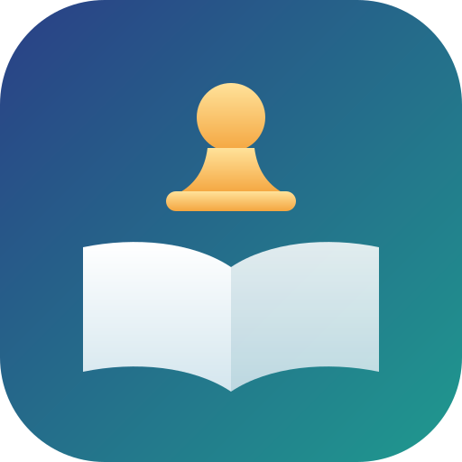
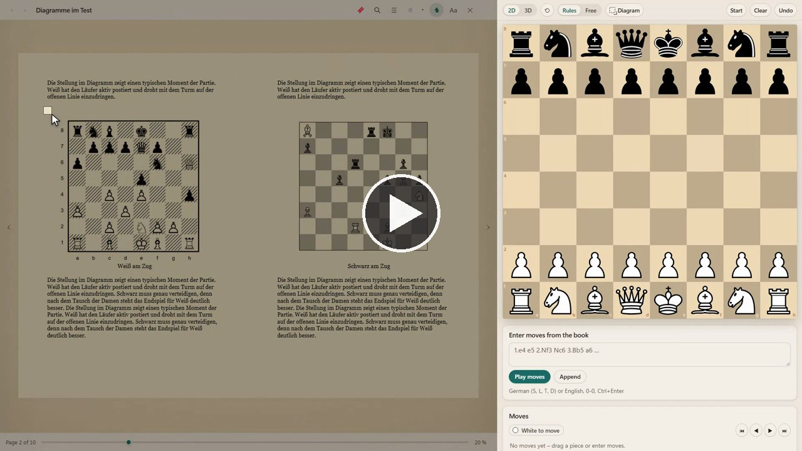

<p align="center"></p>

# Chess Reader

*Deutsch: [README.de.md](README.de.md)*

<p align="center"><a href="https://github.com/regard2462/Chess-Reader/releases/download/v0.1.0/chess-reader-demo.mp4"></a><br><a href="https://github.com/regard2462/Chess-Reader/releases/download/v0.1.0/chess-reader-demo.mp4">Watch the demo video (1 minute, without sound)</a></p>

Chess Reader is an e-reader for the books on your own computer. You choose a folder, the books appear as a list of covers,
and every book opens in a full-screen reader with page turns, bookmarks, notes, a table of contents and a search inside the
book. In chess books a frame drawn around a diagram puts its position on a chessboard next to the page.

It is the reader of Cozy Shelves, the walkable 3D library, as a program of its own: the same reader and the same
diagram recognition, without the 3D world. Nothing in the reader was changed for this.

Chess Reader runs on Windows, Linux, macOS and Android, see [Systems](#systems). The interface is in German and English. The books stay where they are, the
program only reads them. Bookmarks, notes and reading positions are kept by the program.

## Features

**Books**
- EPUB, PDF, MOBI, AZW3, FB2, CBZ, TXT, MD and HTML.
- A list of covers with a search field and the sort orders recently read, title and author. Covers come out of the books
  themselves, a book without a cover gets a title card.
- A progress bar under every book you have started. The reading position is remembered.

**The reader**
- Page turns with the arrow keys, the mouse or the edges of the page, optionally animated. One page or two pages, or scrolling.
- The appearance menu (`S`): page colour (white, paper, sepia, night), font (EB Garamond, Literata, Source Serif, Palatino,
  Atkinson Hyperlegible, Segoe UI), font size, page width, line height, justification and hyphenation.
- Bookmarks (`B`), notes on selected text, the table of contents and a search inside the book (`T`).
- A PDF can be shown as pages or as flowing text in your own font and column width (`X`).

**Chess books**
- `C` puts a chessboard next to the page, `D` starts the diagram lasso. Draw a frame around a diagram in the book, and the
  position appears on the board, with the confidence of the recognition and the squares it is unsure about. A click on a
  square opens the choice of pieces, and the correction is remembered for the book.
- Moves from the book can be typed in and played through. The board is shown in 2D or in 3D.

## Systems

| System | Package | State |
|---|---|---|
| Windows 10 and 11 (x64) | `ChessReader-<version>-win64-portable.zip`, `npm run dist:win` | The main system. The portable package is built here. |
| Android 8.0 or newer | `chess-reader-<version>-release.apk`, `npm run build:android` | Built and signed (checked with `apksigner verify`). Not yet run on a device or an emulator. |
| Linux (x64) | `ChessReader-<version>-linux-x64.tar.gz` and `chessreader_<version>_amd64.deb`, `npm run dist:linux` | Built on Windows, the contents of both archives were checked for completeness. Never started on Linux. |
| macOS (Apple silicon and Intel) | `ChessReader-<version>-mac-arm64.zip` and `-mac-x64.zip`, `npm run dist:mac` | Built on Windows. Not signed, not notarized, never started on a Mac. |

The desktop packages are Electron around the same page. The Android app is a WebView around that page, with the system's
folder picker for the books. Everything else (reader, chess board, diagram recognition) is the same code on all systems.

**Unsigned macOS packages.** macOS blocks an unsigned app. After unpacking, drag `Chess Reader.app` to the Applications folder
and run `xattr -cr "/Applications/Chess Reader.app"` once in a terminal. On a Mac with Apple silicon the app also needs an
ad-hoc signature: `codesign --force --deep --sign - "/Applications/Chess Reader.app"`. Both packages are untested, so
expect problems.

## Use

Windows: start `ChessReader.exe` from the portable package of a release. Linux: unpack the `.tar.gz` and run `./chess-reader`,
or install the `.deb` (`sudo apt install ./chessreader_<version>_amd64.deb`). macOS: see above. Android: install the APK (the
system asks to allow installs from the source you opened it with). On the first start the program asks for a folder with books.
More folders can be added with the button at the top right.

From the source code (Node.js 22 or newer):

```
npm install
npm start
```

`npm run dist:win`, `npm run dist:linux` and `npm run dist:mac` build the packages of the desktop systems into `dist/`.
`npm run build:android` builds the Android app (JDK 17 and the Android SDK are needed, the release key is made once with
`node build/android-keystore.js` and stays in `.android-signing/`, which git ignores). `npm test` builds the page and runs the check in a
headless browser (it needs Microsoft Edge).

## License

Chess Reader is free software under the GNU Affero General Public License, version 3 or later, see [LICENSE](LICENSE). The
third-party components and their licenses are listed in [THIRD_PARTY_NOTICES.md](THIRD_PARTY_NOTICES.md).
